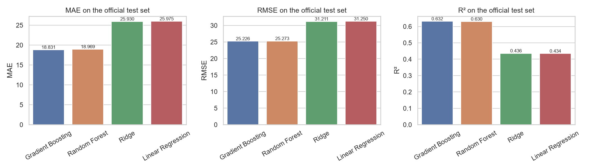

# Aircraft Engine Remaining Useful Life (RUL) Prediction

## Project Description

This project predicts the **remaining useful life (RUL)** of simulated aircraft engines: how many operating cycles an engine can still run before it fails. The prediction uses the current operating cycle, operating settings and sensor readings, and shows how RUL estimates can support predictive-maintenance planning.

The project contains exploratory data analysis, preprocessing, a comparison of four regression models with cross-validation and tuning, and a Streamlit app that compares the saved models side by side.

## Dataset

- **Source** — NASA Prognostics Center of Excellence (PCoE), *Turbofan Engine Degradation Simulation Data Set* (C-MAPSS), item 6 in the [NASA data repository](https://www.nasa.gov/intelligent-systems-division/discovery-and-systems-health/pcoe/pcoe-data-set-repository/).
- **Download** — [NASA dataset ZIP](https://phm-datasets.s3.amazonaws.com/NASA/6.+Turbofan+Engine+Degradation+Simulation+Data+Set.zip).
- **Subset used** — FD001 (one operating condition, one fault mode). The training set has 20,631 rows from 100 engines; each row is one engine at one operating cycle. The other subsets (FD002–FD004) are kept in `Data/Original/` but not used.
- **Target** — Remaining useful life, in operating cycles. For the training engines `RUL = last recorded cycle − current cycle`. For the 100 test engines NASA provides the true RUL at the last observed cycle in `RUL_FD001.txt`.
- `Data/Original/readme.txt` is NASA's own description of the files.

## Repository Structure

```text
project/
├── Data/
│   ├── Original/       # NASA files, never edited
│   └── Cleaned/        # train_FD001_cleaned.csv, created by Notebook 01
├── Notebooks/
│   ├── 01_EDA_and_Preprocessing.ipynb
│   └── 02_Modeling_and_Evaluation.ipynb
├── Models/             # 4 saved pipelines (.joblib), feature_columns.json, result tables
├── Helper/             # helper.py: functions shared by notebooks and app
├── Images/             # plots saved by the notebooks
├── Presentation/       # PowerPoint presentation
├── webapp/             # Bonus: FastAPI backend + space-themed web interface
├── main.py             # Streamlit application
├── requirements.txt    # Python libraries with exact versions
├── .gitignore
└── README.md
```

## Python Version

Python 3.14 (developed and tested with 3.14.6). Other recent Python 3 versions should work with matching package versions.

## Setup Instructions

Open a terminal in the project root (the folder that contains `requirements.txt` and `main.py`).

### 1. Create and activate a virtual environment

**Windows (PowerShell)**

```powershell
python -m venv .venv
.\.venv\Scripts\Activate.ps1
```

**macOS and Linux**

```bash
python3 -m venv .venv
source .venv/bin/activate
```

### 2. Install the dependencies

```bash
python -m pip install -r requirements.txt
```

### 3. Data

The NASA files are already included in `Data/Original/`. If you want to re-download them, extract the NASA ZIP and place `train_FD001.txt`, `test_FD001.txt` and `RUL_FD001.txt` directly in `Data/Original/`.

## Run the Notebooks

From the project root, with the environment activated:

```bash
python -m jupyter notebook
```

Run `Notebooks/01_EDA_and_Preprocessing.ipynb` first (it creates `Data/Cleaned/train_FD001_cleaned.csv`), then `Notebooks/02_Modeling_and_Evaluation.ipynb` (it trains, tunes and saves the models in `Models/`). Both notebooks run from top to bottom with *Run All*; Notebook 02 takes about 3 minutes because of the grid searches. All paths are relative.

## Run the Streamlit App

From the project root:

```bash
python -m streamlit run main.py
```

Open the local URL shown in the terminal (usually http://localhost:8501). In the app you can:

1. pick a model in the sidebar;
2. start from the last observed cycle of any NASA test engine (true RUL shown), edit the readings, and press **Predict RUL**;
3. see the prediction of all four models side by side, with a chart;
4. open the **Model comparison** tab for the MAE / RMSE / R² table and plots.

## Bonus: FastAPI Web App

Besides the required Streamlit app, `webapp/` contains a web version of the same predictor: a **FastAPI** backend that loads the saved models, and a custom HTML/CSS/JavaScript interface with a night-sky theme. It uses the same files in `Models/`, so run the notebooks first.

```bash
python -m uvicorn webapp.server:app
```

Open http://127.0.0.1:8000. The interface has a gauge with the predicted remaining life, moon phases that show where the engine is in its life, a chart of how each model's estimate evolves over the engine's observed cycles, sensor trends, a side-by-side bar chart of the four models (with NASA's true RUL marked), feature importance, dataset facts, editable sensor readings and the test-set metrics. The API is documented automatically at http://127.0.0.1:8000/docs (`GET /api/meta`, `GET /api/engines`, `GET /api/trajectory/{engine_id}`, `GET /api/importance`, `GET /api/dataset`, `POST /api/predict`).

## Work Summary

1. **Set-up** — created the repository structure, a virtual environment and a pinned `requirements.txt`.
2. **EDA** — checked types, missing values, duplicates, the RUL distribution, engine lifetimes, sensor trends, constant columns, outliers and correlations with RUL; wrote a conclusion after each finding.
3. **Preprocessing** — computed the RUL target, removed the 7 constant columns, kept the statistical outliers (they come from real end-of-life degradation), found no need for imputation or categorical encoding, and saved `Data/Cleaned/train_FD001_cleaned.csv`. The model input has **18 features**: `cycle`, 2 operating settings and 15 sensors. `engine_id` is used only for grouping.
4. **Splitting without leakage** — all splits are by engine (`GroupShuffleSplit` with `random_state=42` and `GroupKFold`), because rows of one engine are strongly dependent. Scaling happens *inside* the model pipelines, so the scaler is fitted only on training data and is saved with each model.
5. **Models** — Linear Regression, Ridge, Random Forest and Gradient Boosting (`StandardScaler` for the two linear models, none for the tree models), compared with 5-fold grouped cross-validation.
6. **Tuning** — `GridSearchCV` with grouped folds for Ridge, Random Forest and Gradient Boosting, choosing by mean validation RMSE.
7. **Final evaluation** — final models were fitted on all 100 training engines and evaluated once on the official FD001 test set (the last observed row of each of the 100 test engines, compared with NASA's true RUL).
8. **Saving and app** — saved all four fitted pipelines and built the Streamlit app that loads them.

## Final Results

Official NASA FD001 test set (100 engines):

| Model | MAE (cycles) | RMSE (cycles) | R² |
|---|---:|---:|---:|
| Gradient Boosting | **18.831** | **25.226** | **0.632** |
| Random Forest | 18.969 | 25.273 | 0.630 |
| Ridge | 25.930 | 31.211 | 0.436 |
| Linear Regression | 25.975 | 31.250 | 0.434 |

Cross-validation (5 grouped folds on the training engines) ranks the models the same way: Gradient Boosting RMSE 37.2, Random Forest 37.5, Ridge 40.6.

**Selected model — Gradient Boosting (tuned: 200 trees, learning rate 0.05, depth 2).** It has the lowest MAE and RMSE and the highest R² on the test set and also won in cross-validation. On average its prediction is 18.8 cycles away from the true RUL. Random Forest is almost tied (0.14 cycles higher MAE), so the choice between the two is not strong evidence on 100 engines; both are about 19% better in RMSE than the linear models, because the sensor–RUL relationship is non-linear.



### Limitations
- The model overestimates RUL for 69 of the 100 test engines (average +10.5 cycles) and for 21 of the 25 engines that are within 30 cycles of failure. That is the risky direction for maintenance.
- `cycle` is by far the most important feature (importance ≈ 0.64), which works for FD001 but may not generalise to other operating conditions (FD002–FD004).
- Data is simulated, and the app is an educational prototype, not a maintenance tool.

### Extra experiment
Capping the target at 125 cycles raises R² (Gradient Boosting 0.632 → 0.837), but the true target is capped too, so it is an easier task and not directly comparable. It is reported in Notebook 02 only as an idea for improvement; the saved models use the real RUL.

## References

- Saxena, A., & Goebel, K. (2008). *Turbofan Engine Degradation Simulation Data Set*. [NASA Prognostics Data Repository](https://www.nasa.gov/intelligent-systems-division/discovery-and-systems-health/pcoe/pcoe-data-set-repository/).
- [Scikit-learn documentation](https://scikit-learn.org/stable/)
- [Streamlit documentation](https://docs.streamlit.io/)
